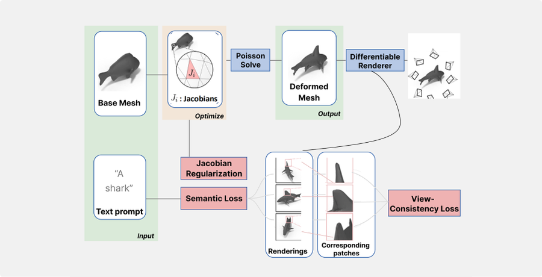
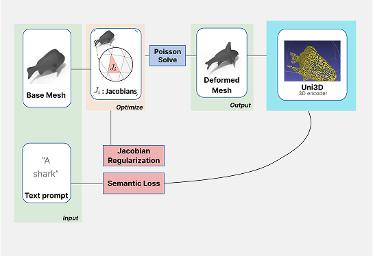
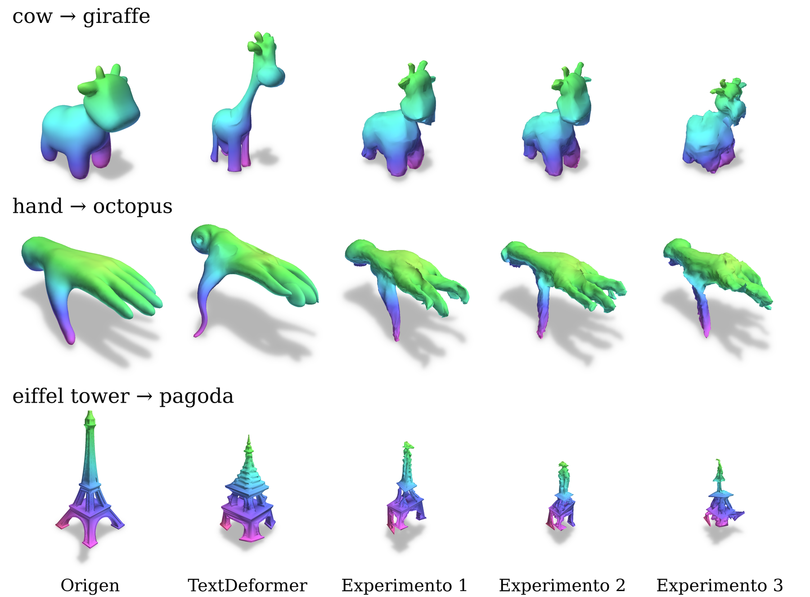

# UniTextDeformer

**¿Podemos guiar la deformación de una malla sin recurrir a imágenes 2D?**

Esta implementación adapta [TextDeformer](https://github.com/threedle/TextDeformer)
para sustituir su supervisión semántica visual por embeddings de
[Uni3D-B](https://github.com/baaivision/Uni3D). Se mantienen los Jacobianos por cara,
la reconstrucción mediante Poisson y la regularización de identidad. Los encoders
están congelados; el gradiente atraviesa el muestreo de superficie hasta la geometría.

[Instalación](INSTALL.md) · [Protocolo](PROTOCOL.md) · [Casos y prompts](configs/cases.json)

## Método

<table>
  <tr>
    <th width="50%">TextDeformer: supervisión semántica mediante renders y CLIP</th>
    <th width="50%">UniTextDeformer: supervisión semántica mediante Uni3D</th>
  </tr>
  <tr>
    <td></td>
    <td></td>
  </tr>
</table>

El esquema Uni3D muestra la rama semántica sin renderizado. La variante con VC
conserva el renderizado diferenciable y CLIP para la consistencia entre vistas.
El esquema original se redibuja a partir de Gao et al. (2023).

| Experimento | Identificador CLI | LP | DeltaP | Identidad | VC |
|---|---|---|---|---|---|
| TextDeformer | [Implementación oficial](https://github.com/threedle/TextDeformer) | CLIP | CLIP | ✓ | CLIP |
| Experimento 1 | `uni3d-vc` | Uni3D | Uni3D | ✓ | CLIP |
| Experimento 2 | `uni3d-no-vc` | Uni3D | Uni3D | ✓ | — |
| Experimento 3 | `uni3d-no-vc-no-delta` | Uni3D | — | ✓ | — |

TextDeformer y el Experimento 1 usan `LP + DeltaP + 0,5 LI − 0,5 VC`;
los Experimentos 2 y 3 usan `LP + DeltaP + 0,5 LI` y `LP + 0,5 LI`, respectivamente.
VC se expresa como similitud, de ahí su signo negativo.

**Condiciones:** 20 pares de malla/prompt, 7 mallas, semilla 42, 2.500 iteraciones,
Adam con lr 0,0025 y 10.000 puntos en las variantes Uni3D. TextDeformer y el
Experimento 1 usan 10 cámaras y renders de 512×512. Las variantes sin VC no
crean cámaras ni renders de entrenamiento.

## Resultados

| Experimento | CLIP R-Precision (L/14) ↑ | Intersecciones ↓ | Tiempo medio ↓ |
|---|---:|---:|---:|
| TextDeformer | **90,0 %** | **2,54 %** | 13 min 43 s |
| Experimento 1: Uni3D con VC | 55,0 % | 4,78 % | 13 min 30 s |
| Experimento 2: Uni3D sin VC | 55,0 % | 8,02 % | 3 min 46 s |
| Experimento 3: Uni3D sin VC ni DeltaP | 50,0 % | 10,45 % | **1 min 45 s** |

Resultados sobre los 20 casos cuantitativos del manifiesto. R-Precision utiliza
CLIP ViT-L/14 y 16 vistas por malla; intersecciones es la media del porcentaje
de caras con autointersecciones. Tiempo es la media de optimización por caso,
excluyendo inicialización, exportación y evaluación. Los tiempos dependen del
hardware y de los recursos disponibles durante la ejecución.

En este conjunto, Uni3D reduce la correspondencia semántica respecto de
TextDeformer. Incorporar VC reduce las intersecciones del 8,02 % al 4,78 %, sin
mejorar R-Precision. Las variantes sin VC registran menores tiempos de optimización.

[Tabla en LaTeX](assets/tables/results.tex) · [Valores de referencia](assets/tables/results.json)



Columnas: origen, TextDeformer, Experimento 1, Experimento 2 y Experimento 3.
Mano→pulpo y torre Eiffel→pagoda corresponden a C07 y C04.
Vaca→jirafa es el ejemplo opcional Q01 de [configs/qualitative.json](configs/qualitative.json)
y no entra en los 20 casos cuantitativos.

## Replicar

1. Completar [INSTALL.md](INSTALL.md): entorno, fuentes públicas fijadas, extensiones
   y pesos. Las siete mallas están incluidas.
2. Revisar el plan y comprobar las tres variantes Uni3D con una prueba corta:

   ```bash
   python run.py --dry-run
   python run.py --cases C02 --steps 2 --output outputs/smoke
   ```

3. Ejecutar cada experimento por separado. Cada comando completa sus 20 casos
   antes de volver a la terminal; esperar su finalización antes del siguiente:

   ```bash
   conda run -n TextDeformer python scripts/run_textdeformer.py --output outputs/textdeformer
   python run.py --variants uni3d-vc --output outputs/experiment
   python run.py --variants uni3d-no-vc --output outputs/experiment
   python run.py --variants uni3d-no-vc-no-delta --output outputs/experiment
   ```

TextDeformer se ejecuta desde su repositorio original y en su propio entorno,
preparado según [sus instrucciones](https://github.com/threedle/TextDeformer#installation).
`scripts/run_textdeformer.py` sólo pasa los casos, prompts y parámetros a su
`main.py`; no modifica su código ni sus pérdidas. Usa `external/TextDeformer`
por defecto; `--repo` permite indicar otro checkout original y `--python` su
intérprete. Para revisar el plan o hacer una prueba corta:

```bash
conda run -n TextDeformer python scripts/run_textdeformer.py --dry-run
conda run -n TextDeformer python scripts/run_textdeformer.py --cases C02 --steps 2 --output outputs/smoke-textdeformer
```

Ambos lanzadores esperan a que termine cada proceso antes de iniciar el siguiente.
Las salidas de cada experimento ocupan directorios independientes.

Después de completar TextDeformer, también se pueden ejecutar las tres variantes
Uni3D con un único comando, **60 optimizaciones**:

```bash
python run.py --output outputs/experiment
```

El orden de reproducción es TextDeformer completo → Experimento 1 completo →
Experimento 2 completo → Experimento 3 completo, **80 optimizaciones** en total.
`run.py --variants` selecciona una o varias variantes Uni3D y conserva el orden
1 → 2 → 3, completando todos los casos de cada variante. Si un proceso falla,
su lanzador se detiene.

Para seleccionar casos o reproducir el ejemplo cualitativo adicional:

```bash
python run.py --cases C04 C07 --variants uni3d-no-vc --output outputs/subset
python run.py --manifest configs/qualitative.json --output outputs/qualitative
```

Usar una salida nueva para cada combinación de caso y experimento. Los tres
comandos Uni3D pueden compartir `--output`, porque cada variante tiene su propia
carpeta. En `run.py`, `--skip-complete` omite optimizaciones completas con igual
configuración/código y hashes válidos de malla final y checkpoint.
Una optimización incompleta necesita otra salida; no se reanuda automáticamente.

## Salidas y configuración

Para Uni3D, cada `outputs/experiment/Cxx/variante/` contiene la malla en `mesh_final/mesh.obj`,
`config.yml`, `run.json`, `checkpoint.pt`, `references.pt`, los registros escalares
`steps.jsonl`/`numerical_events.jsonl` y las matrices auxiliares de Poisson en `tmp/`.
Todas las rutas de configuración se guardan relativas al repositorio.

TextDeformer conserva sus salidas originales en `outputs/textdeformer/Cxx/`,
incluidas `mesh_final/mesh.obj`, `config.yml`, imágenes y logs. Las convenciones
de checkpoint y protección numérica que siguen corresponden a las variantes Uni3D.

`status: complete` indica finalización. `numerical_guard` informa las actualizaciones
Adam aceptadas y las intervenciones numéricas. La malla exportada usa los vértices
anteriores al último paso de Adam; el checkpoint guarda el estado posterior.
Las convenciones completas están en [PROTOCOL.md](PROTOCOL.md).

Editar `configs/experiment.yml` para cambiar pasos, semilla, puntos, cámaras o
aprendizaje. Para otras mallas/prompts, crear un manifiesto con el formato de
`configs/cases.json` y usar `--manifest`. Guardar inputs, pesos y salidas dentro
del repositorio. Para un input nuevo, actualizar u omitir `mesh_sha256`.
Las tres ablaciones se definen en `unitextdeformer/config.py`.

## Referencias y licencias

- [TextDeformer](https://github.com/threedle/TextDeformer): Gao et al., SIGGRAPH 2023.
- [Uni3D](https://github.com/baaivision/Uni3D): Zhou et al., ICLR 2024.

El código derivado de TextDeformer conserva [su licencia MIT](LICENSE).
`unitextdeformer/render.py` y el parche de `nvdiffmodeling` están sujetos a
[la licencia NVIDIA incluida](licenses/NVIDIA.txt), para investigación/evaluación
no comercial. Las dependencias y pesos conservan sus licencias originales.
